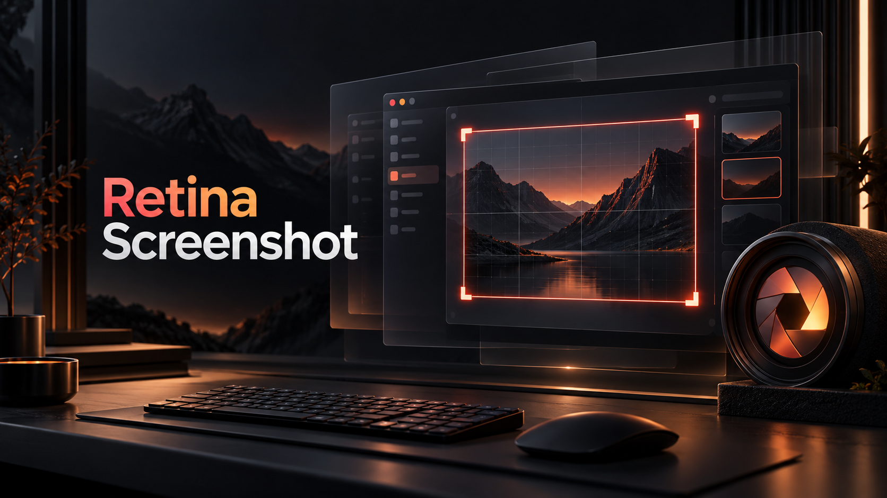

<div align="center">
  

  <p><strong>Beautiful screenshots. Crisp text. Every detail.</strong></p>

  <p>
    <a href="https://github.com/markey/omarchy-retina-screenshot/releases"></a>
    <a href="LICENSE"></a>
    
    
  </p>
</div>

## What it does

Retina Screenshot lets you select a region inside any visible window, or select
a whole window, before moving its **entire workspace** to a temporary 2×
headless output. Wayland-native applications get a real high-DPI configure event
and can repaint text, icons, SVGs, browser content, and toolkit UI at the higher
buffer scale. The result is captured with `grim`, copied with `wl-copy`, and
saved to the normal Omarchy screenshot directory.

This is rendering, not interpolation. The script never mirrors the physical
display and does not upscale a normal screenshot afterward.

## Why the whole workspace moves

Removing one tiled window and inserting it again can change Hyprland's tiling
tree. Moving the workspace preserves tiled order, groups, floating geometry,
fullscreen state, and the target window's logical dimensions. Only the selected
region or selected window rectangle is captured. The workspace is returned
before the temporary output is destroyed.

## Requirements

- Omarchy 4.x / Hyprland with named headless outputs
- `hyprctl`, `grim`, `wl-copy`, `jq`, `flock`
- A Wayland-native target application for a guaranteed high-DPI repaint

Earlier releases were live-tested on Omarchy 4.0.4 with Hyprland 0.56.2.
Version 1.1.7 was live-tested with Hyprland 0.57.0 and Omarchy's 4.5 workspace
management. Numbered workspaces are expected to remain compatible with the
older setup, but 1.1.8 has not been live-tested on Omarchy 4.0; custom named
workspaces on older Hyprland versions remain unverified. The script uses
Hyprland's Lua monitor/dispatcher API when available and retains a legacy
dispatcher fallback for older configurations.

**Omarchy 4.5 requires the user-config compatibility helper described below.**
Installing the plugin alone does not enable that helper.

The script detects the focused monitor's physical size and scale. For example,
a 3440×1440 output at 1.25× has a 2752×1152 logical area, so v1 creates a
5504×2304 output at scale 2. A 1920×1080 output at scale 1 creates the familiar
3840×2160 output at scale 2.

## Install

From a published Git repository:

```bash
omarchy plugin add https://github.com/markey/omarchy-retina-screenshot.git --enable --yes
```

For local development:

```bash
mkdir -p ~/.config/omarchy/plugins
cp -a ./omarchy-retina-screenshot ~/.config/omarchy/plugins/mark.retina-screenshot
omarchy plugin validate ~/.config/omarchy/plugins/mark.retina-screenshot
omarchy plugin enable mark.retina-screenshot right
```

Left-clicking the bar camera opens Omarchy's frozen-screen region picker. The
pointer changes to the normal selection cursor; drag a rectangle entirely inside
the window you want. Right-clicking opens the save/clipboard options panel, with
separate **Select a region** and **Select a whole window** buttons.

## Hyprland 0.57 selectors

Version 1.1.8 passes workspace names directly to Lua move/focus dispatchers,
matching Hyprland 0.57's selector API. The former `name:1` selector is rejected
as `Invalid workspace`; workspace `1` must be passed as `"1"`. Legacy non-Lua
dispatchers retain their older selector syntax. Dispatcher errors are now
reported instead of discarded. The mock suite runs both dispatcher paths.

## Omarchy 4.5 workspace compatibility

Version 1.1.8 includes `compat/workspaces.lua`. Omarchy 4.5 assigns workspace
blocks to monitors, including temporary outputs. If the last physical display
disconnects, its occupied workspaces can be renumbered onto `FALLBACK`, then fail
to regain their original numbers when empty persistent workspaces occupy those
numbers. A config reload during capture can also adopt the captured workspace
into the temporary output's block.

After installing the plugin, add this **after** `require("default.hypr.omarchy")`
in `~/.config/hypr/hyprland.lua`:

```lua
local retina_compat = os.getenv("HOME") .. "/.config/omarchy/plugins/mark.retina-screenshot/compat/workspaces.lua"
local retina_file = io.open(retina_compat, "r")
if retina_file then
  retina_file:close()
  dofile(retina_compat)
end
```

Then run `hyprctl reload` and `hyprctl configerrors`. The optional-file check
allows normal login if the plugin is subsequently removed. The helper is a
user-owned workaround for Omarchy 4.5's internal `o.workspaces.reconcile` API,
not an upstream extension API; future Omarchy versions may require adaptation.
It is a no-op if that API is unavailable.

The helper defers automatic workspace reconciliation while `FALLBACK` or
`RETINA-SCREENSHOT` is present, or while no physical display remains. Normal
reconciliation resumes on the next monitor/config event after temporary outputs
are gone. It uses output lifetime rather than a process lock, so configuration
reloads during capture remain covered. No packaged Omarchy files are modified.
It prevents new renumbering; it does not rearrange already-displaced windows.

Cleanup follows the selected window's address to its current workspace rather
than assuming the original workspace number survived. If restoration fails,
the capture reports failure and retains the temporary output and runtime
`state.json` for recovery instead of destroying an output that may hold windows.
In that case automatic reconciliation remains deferred until that output is
removed. Once the physical display is available, use the recorded target window
to identify its **current** workspace, move that whole workspace back, verify it
arrived, and only then remove `RETINA-SCREENSHOT`. Do not start another capture
until recovery is complete.

## Uninstall

Remove the installed plugin and its bar entry with:

```bash
omarchy plugin remove mark.retina-screenshot --yes
```

Saved screenshots are ordinary image files and are not deleted when the plugin
is removed.

## Keyboard shortcut

The service exposes a plugin action:

```bash
omarchy-shell mark.retina-screenshot capture          # region picker
omarchy-shell mark.retina-screenshot captureRegion    # region picker
omarchy-shell mark.retina-screenshot captureWindow    # window picker
```

Or invoke the script directly:

```bash
~/.config/omarchy/plugins/mark.retina-screenshot/scripts/retina-screenshot
```

Add a user-owned binding to `~/.config/hypr/bindings.lua` only if you want it.
This example does **not** replace Omarchy's normal screenshot shortcut:

```lua
o.bind("SUPER + SHIFT + R", "Retina Screenshot", "omarchy-shell mark.retina-screenshot capture")
```

If you deliberately want `SUPER + SHIFT + S`, unbind or change the existing
Omarchy screenshot action first rather than creating a collision.

## Script usage

```text
retina-screenshot [--region|--window] [--scale 2] [--delay SECONDS]
                  [--copy|--no-copy] [--save|--no-save]
                  [--output-dir DIRECTORY] [--diagnose] [--debug]
```

Useful checks:

```bash
scripts/retina-screenshot --diagnose
RETINASHOT_DEBUG=1 scripts/retina-screenshot --delay 1.5
```

The save directory follows `OMARCHY_SCREENSHOT_DIR`, `XDG_PICTURES_DIR`, then
`~/Pictures`, matching Omarchy's screenshot command.

## Safety and cleanup

Before changing the compositor, the script records the focused window, monitor,
workspace, tiled/floating state, fullscreen state, and geometry. A single-instance
lock prevents overlapping captures. `EXIT`, `INT`, and `TERM` traps restore the
workspace, window details, and focus before removing the uniquely named headless
output. The reserved output name is `RETINA-SCREENSHOT`; using one stable name
also prevents runtime monitor rules from accumulating under per-process names.
The same cleanup runs when output configuration, repaint, `grim`, or
clipboard copying fails. Long-lived clipboard and notification helpers receive
no copy of the capture-lock descriptor, so they cannot block the next capture.
The picker also temporarily uses Omarchy's hardware-cursor setting so the live
selection cursor remains visible over the frozen desktop, restoring the user's
previous cursor mode on every exit path.
The picker keeps that frozen frame over the physical display while the workspace
visits the headless output, then removes it only after the original workspace,
window state, and focus have been restored and stable for a short compositor
grace period. Because that output is created only after the cover starts, the
frozen frame is not present in the Retina capture.
Picker startup is deferred until the Shell has finished dispatching the bar or
panel click, preventing the new selection surface from inheriting a stale
pointer grab.

The picker always receives `/dev/null` on stdin so Quickshell's open process
pipe cannot make `slurp` wait forever for rectangle input. Picker descendants
do not inherit the capture lock, the picker has a 60-second deadline, the full
Shell action has a three-minute watchdog, and capture/clipboard/notification
helpers have their own short deadlines. Cancellation and signals terminate the
entire picker process group before restoring cursor and desktop state.

Pinned windows and special workspaces are rejected in v1 because moving them
safely without changing unrelated desktop state is not guaranteed.

## Cursor-free screenshots

The mouse pointer is excluded from saved images and the clipboard. It remains
visible during selection, then is temporarily hidden only for the final capture
and parked on the original display outside the capture output. Its position and
previous visibility are restored afterward. One readback is discarded
to flush a stale compositor frame before the final image. This also excludes software
cursors on the temporary headless display, which may otherwise appear even
without grim's cursor flag. Failure and interruption cleanup restore visibility;
an already-hidden cursor stays hidden. Capture fails clearly if the compositor
cannot provide visibility control.

Version 1.1.8 was checked with a software pointer deliberately placed over a
test window: the final image matched the cursor-free reference pixel for pixel,
and the window, pointer position, and cursor visibility were restored.

## Accuracy notes

- Native Wayland Chromium/Electron, Qt, and GTK apps can react to the output's
  integer buffer scale and render real additional detail.
- XWayland has no general per-output HiDPI mechanism. The script warns but still
  captures; such a window may remain low-resolution or be compositor-scaled.
- Hyprland does not expose a universal "application finished repainting" event.
  v1 waits for the temporary output to reproduce the source monitor's reserved
  margins, then waits for stable compositor geometry and uses a configurable
  one-second repaint delay. This prevents a late bar reservation from briefly
  resizing tiled applications before capture. Increase `--delay` for a slow
  application.
- Region mode is the default. The selection must fit entirely inside one visible
  regular workspace window. Window mode uses Omarchy's highlighted window picker.
- Workspace, 3×, and supersampled-downsample modes are not implemented.

## Validate and test

```bash
omarchy plugin validate .
bash -n scripts/retina-screenshot tests/test-retina-screenshot.sh
tests/test-retina-screenshot.sh
MOCK_LUA=1 tests/test-retina-screenshot.sh
lua tests/test-workspaces.lua
```

The test harness mocks Hyprland and verifies renumbered-workspace restoration,
interruption, failed restoration, region translation, selection of a
window other than the focused one, frozen-cover ordering and cleanup,
cancellation, successful cleanup, and cleanup after a forced `grim` failure.

The Lua test runs the installed Omarchy workspace manager against an in-memory
desktop, reproducing the fallback bug without the helper and preventing it with
the helper. It also checks reconciliation during capture and after output removal.

Live verification of 1.1.7 on Hyprland 0.57.0 produced a 5456×2204 PNG from a
2728×1102 logical test window, with its workspace and geometry restored and the
temporary output removed. Existing windows kept their workspace assignments.

Earlier live verification (before 1.1.7) on the test system produced:

- floating window: 900×650 logical → 1800×1300 PNG, identical state afterward
- tiled window: 2728×1102 logical → 5456×2204 PNG, identical state afterward
- no `RETINA-*` output remaining after either capture

## License

MIT
